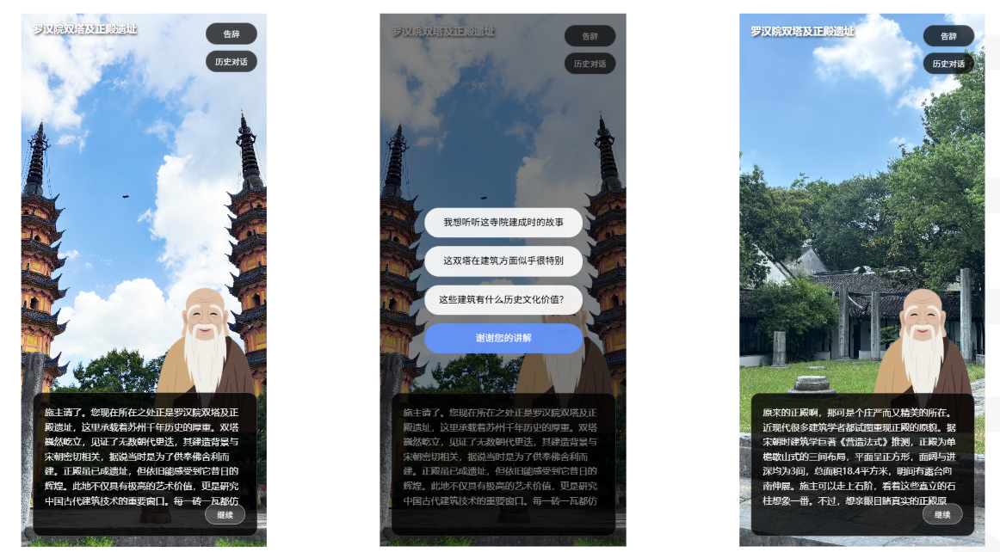

# 双塔导览剧情游戏

Github repo: https://github.com/willow-hu/interactive-narrative-game-ch

在实地游览苏州双塔的过程中游玩该交互游戏，以更有趣、更沉浸式的方式了解双塔的历史。

游戏中游客将与妙思住持对话，选择自己感兴趣的话题与其深入交流，听他讲述双塔的历史故事。

## 痛点

传统的景区内导览缺少游戏性和乐趣，较为无聊。

## 产品设计

使用交互文本对话游戏的形式，使玩家与双塔相关的一个历史人物——妙思主持——对话，通过妙思的介绍来了解双塔。

### 设计亮点

- 【核心设计】不同游客关心的问题可能不同，如有些游客感兴趣建筑技法，有些游客感兴趣历史背景。游戏脚本设计时划分了主题，设置了不同分支。游戏中玩家可以选择自己选择感兴趣的话题提问以探索分支。
- 为了方便玩家找到每段描述所对应的物体或场景，游戏中的背景照片为实拍且根据内容切换，方便用户对照。
- 玩家若探索了所有分支，游戏结束时会获得成就奖励。

## 如何体验

打开应用后点击“开始游戏”，阅读对话并选择感兴趣的话题。可以查看历史对话、探索不同分支，完整探索可解锁成就。

游戏适合在手机上体验，无需注册或上传文件。
