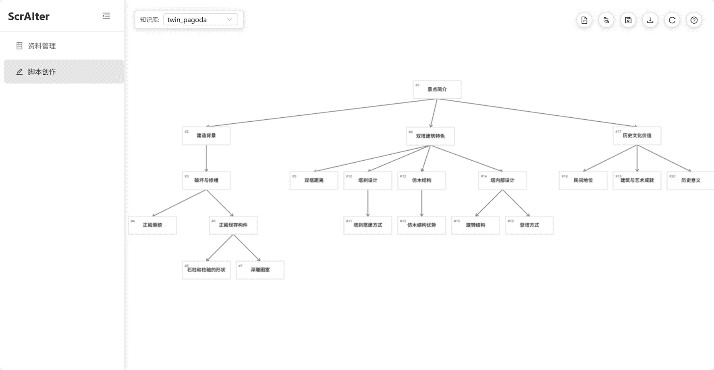

# ScrAIter

Github repo: https://github.com/willow-hu/ScrAIter

ScrAIter = Script + AI + writer, 是一个AI驱动的交互游戏脚本创作工具，目的是针对一个遗址地创作出一个交互导览游戏（参考我的另一个应用“双塔导览剧情游戏”）的脚本。

用户将上传相关资料到系统，AI将首先创作出一个基础树状结构，表示剧情分支，而后每个节点上用户都可以让AI生成一段文字，也就是NPC说的话。用户可以随时修改树状结构和节点内容。详情可[参考说明](ProjectOverview.pdf)。

## 痛点

遗址导览交互游戏脚本内容的创作耗时费力，且往往需要专业人士。

## 产品设计

本系统利用大模型的能力将脚本设计这一工作程式化和自动化，提出了一个适合人与大模型合作创作脚本的工作流。

### 工作流

### 使用方法

1. 用户上传资料构建知识库。
1. AI根据主题设计分支，创作树状图初稿。树状图只显示结构和节点的要点（提纲），无细节内容。
1. 用户根据自己的想法修改树状图，或要求AI重新生成。
1. 用户进入节点，在每个节点处撰写用户提问（选项）和内容摘要，并限制字数，AI自动生成详细内容。
1. 用户微调内容，完成所有节点后即完成脚本创作。

### 设计亮点

- 为了保证内容的权威性和真实性，排除网络虚假信息的影响，本系统采用了RAG技术。
- 每次生成详细介绍内容，关联度最高的五个片段会显示在界面上，方便创作者参考。

⚠️ 注：当前为只读展示版，上传、修改、保存和 AI 生成功能暂未开放。
